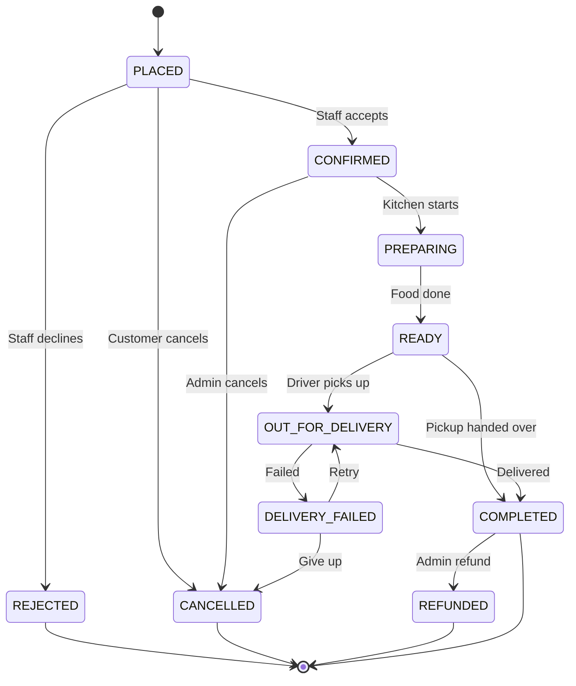
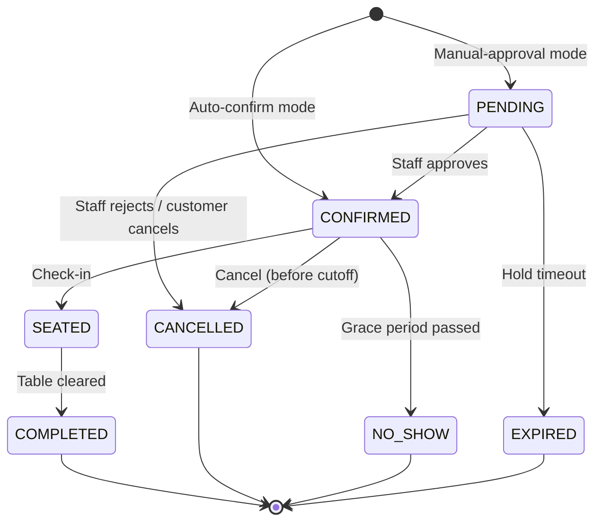
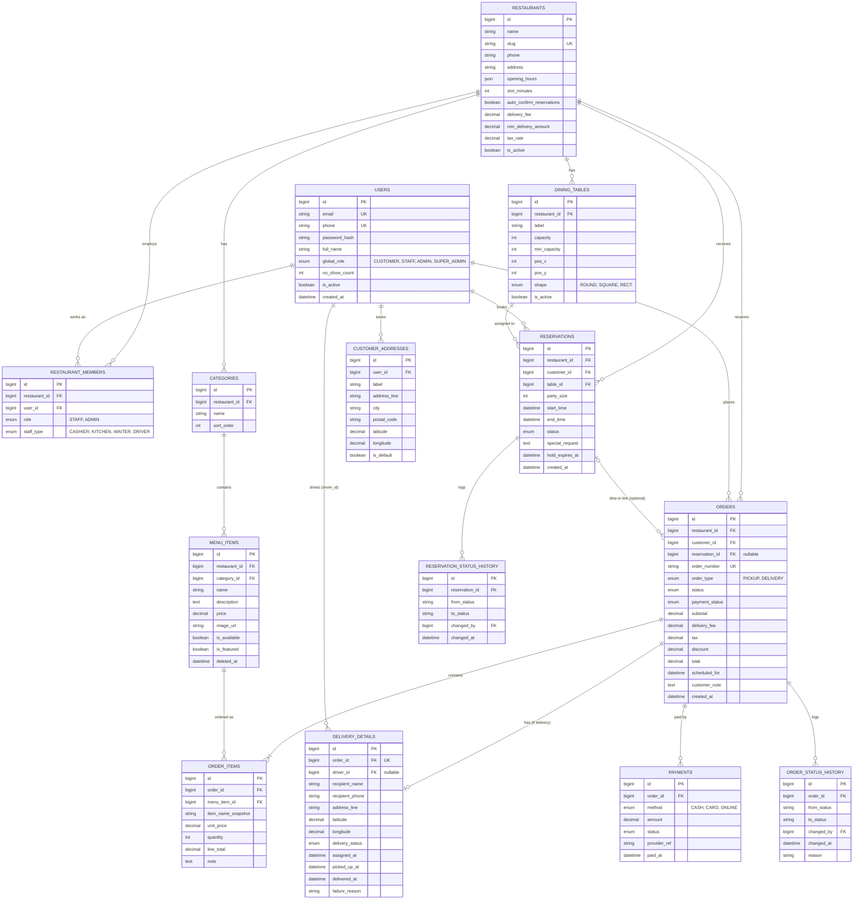
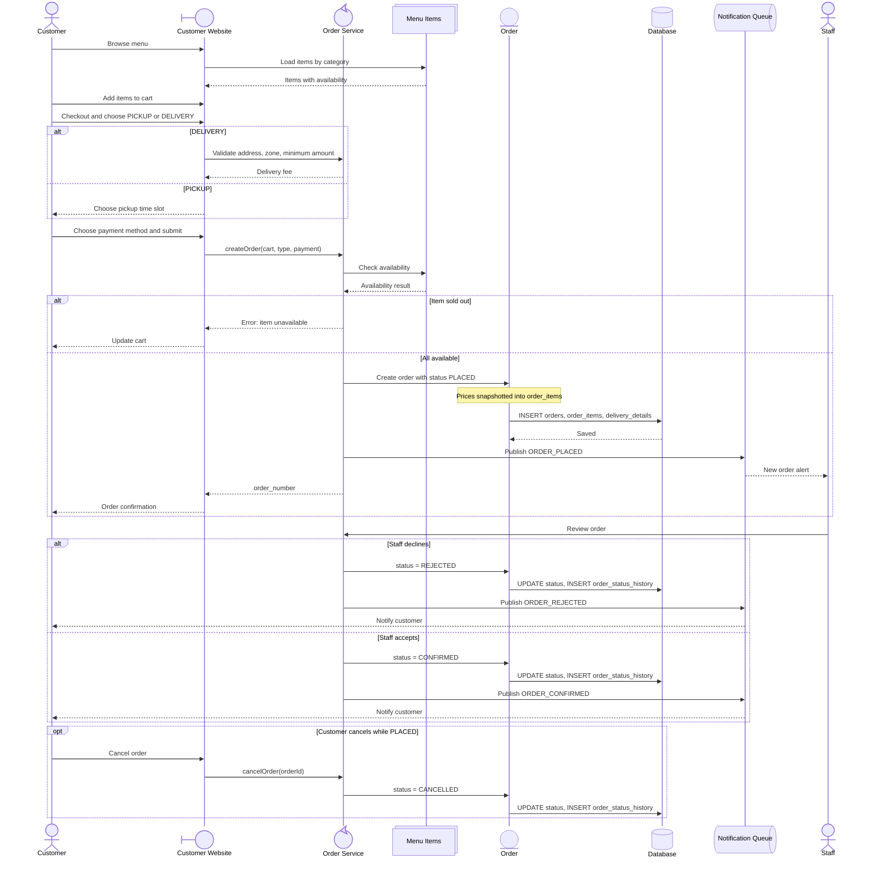
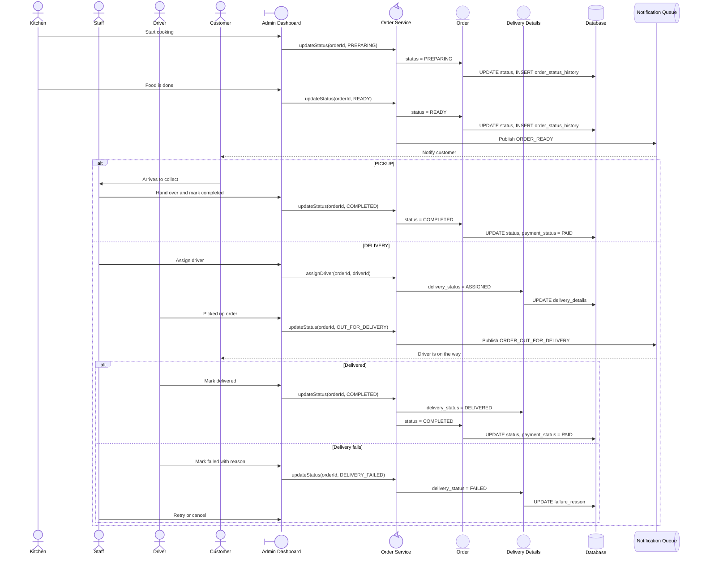
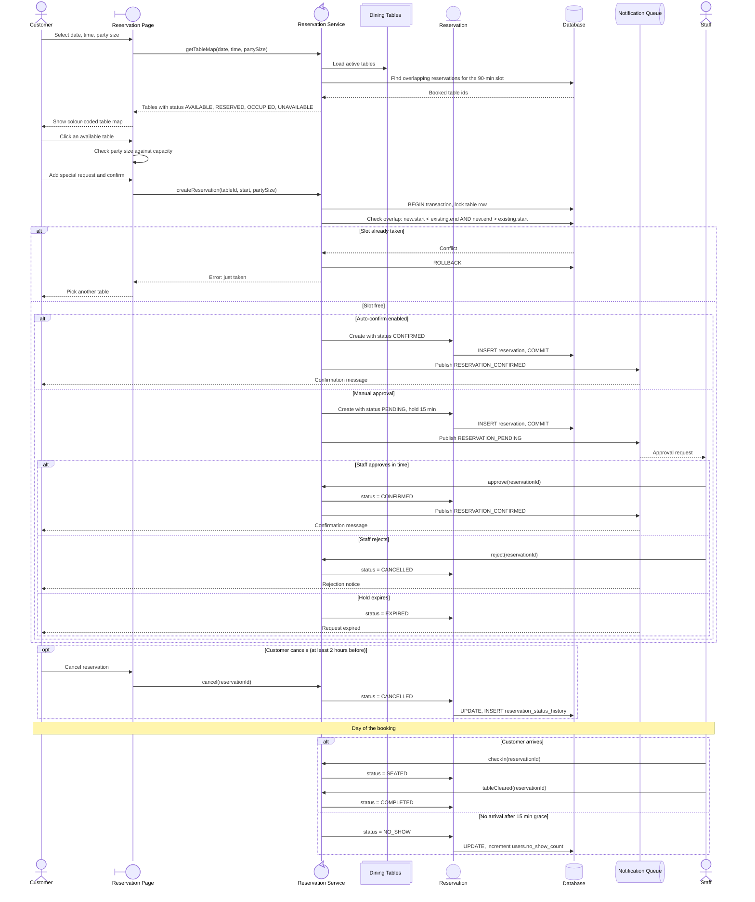
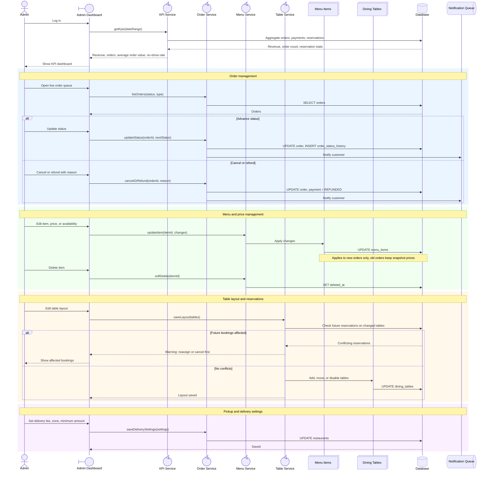
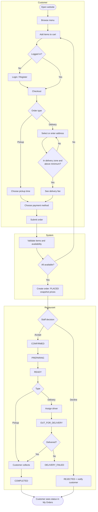
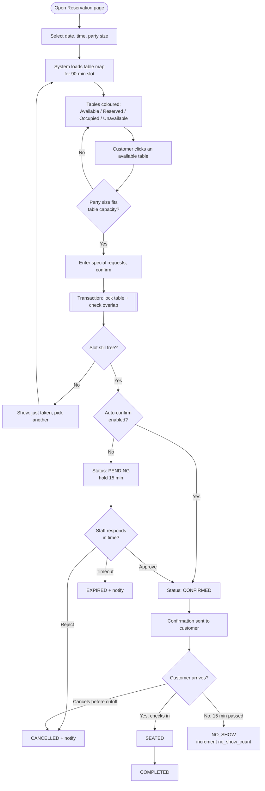
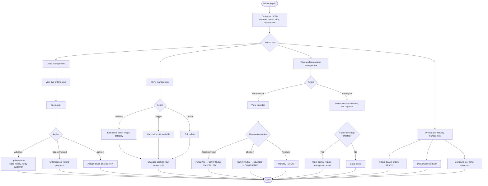

# Restaurant Management System: Complete Design Specification

**Assumption:** "Multiple customers" is treated as **multi-tenant**. One platform serves many restaurants, and every business table carries `restaurant_id`. Each restaurant has its own menu, tables, staff, and orders. If you meant a single restaurant with many diners, drop `restaurants` and `restaurant_id`; nothing else changes.

## Contents

1. [User Roles & Permissions](#1-user-roles--permissions)
2. [Status Definitions](#2-status-definitions)
3. [Business Rules](#3-business-rules)
4. [Feature List](#4-feature-list)
5. [ERD](#5-erd)
6. [Sequence Diagrams](#6-sequence-diagrams)
7. [Build Order](#7-suggested-build-order)
8. [Appendix: Activity Flowcharts](#appendix-activity-flowcharts)

---

## 1. User Roles & Permissions

| Role | Who | Scope |
|---|---|---|
| **Guest** | Not logged in | Public |
| **Customer** | Registered diner | Own data only |
| **Staff** | Cashier, kitchen, waiter, driver | One restaurant, operational |
| **Admin** | Owner or manager | One restaurant, full control |
| **Super Admin** | Platform operator | All restaurants (optional) |

### Permission matrix

| Capability | Guest | Customer | Staff | Admin |
|---|:-:|:-:|:-:|:-:|
| View home, menu, table availability | ✅ | ✅ | ✅ | ✅ |
| Place order (pickup/delivery) | ❌ | ✅ | ✅ (on behalf, walk-in) | ✅ |
| Make or cancel own reservation | ❌ | ✅ | ✅ (any) | ✅ (any) |
| View own orders/reservations | ❌ | ✅ | ❌ | ❌ |
| View all orders/reservations | ❌ | ❌ | ✅ | ✅ |
| Update order status | ❌ | ❌ | ✅ (forward only) | ✅ (any, incl. cancel/refund) |
| Check in / seat / no-show reservations | ❌ | ❌ | ✅ | ✅ |
| Assign delivery driver | ❌ | ❌ | ✅ | ✅ |
| Edit menu, prices, availability | ❌ | ❌ | ✅ (toggle sold-out only) | ✅ (full) |
| Edit table layout | ❌ | ❌ | ❌ | ✅ |
| View KPIs and revenue | ❌ | ❌ | ❌ | ✅ |
| Manage staff accounts and settings | ❌ | ❌ | ❌ | ✅ |

**Staff sub-roles** (stored in `restaurant_members.staff_type`): `CASHIER`, `KITCHEN`, `WAITER`, `DRIVER`. Kitchen sees only orders in `CONFIRMED → READY`. Drivers see only their deliveries.

---

## 2. Status Definitions

### 2.1 Order status

| Status | Meaning | Set by | Next |
|---|---|---|---|
| `PLACED` | Customer submitted, awaiting restaurant | Customer | CONFIRMED, REJECTED, CANCELLED |
| `CONFIRMED` | Restaurant accepted, payment OK or COD | Staff/Admin | PREPARING, CANCELLED |
| `PREPARING` | Kitchen is cooking | Kitchen | READY |
| `READY` | Food done; waiting for pickup or driver | Kitchen | COMPLETED (pickup), OUT_FOR_DELIVERY (delivery) |
| `OUT_FOR_DELIVERY` | Driver has the order | Driver/Staff | COMPLETED, DELIVERY_FAILED |
| `COMPLETED` | Handed over / delivered | Staff/Driver | REFUNDED (Admin) |
| `CANCELLED` | Cancelled by customer or restaurant | Customer (only while PLACED) / Admin | terminal |
| `REJECTED` | Restaurant declined (closed, out of stock) | Staff/Admin | terminal |
| `DELIVERY_FAILED` | Couldn't deliver | Driver/Admin | OUT_FOR_DELIVERY (retry), CANCELLED |
| `REFUNDED` | Money returned after completion | Admin | terminal |

### 2.2 Payment status (separate from order status)

| Status | Meaning |
|---|---|
| `UNPAID` | Not yet paid (COD or awaiting online payment) |
| `PAID` | Payment captured |
| `FAILED` | Online payment failed |
| `REFUNDED` | Fully or partially refunded |

### 2.3 Reservation status

| Status | Meaning | Set by |
|---|---|---|
| `PENDING` | Requested, awaiting approval (only if the restaurant uses manual approval; the slot is held) | Customer |
| `CONFIRMED` | Table locked for the time slot | System/Staff |
| `SEATED` | Customer arrived and was seated | Staff |
| `COMPLETED` | Dining finished, table released | Staff |
| `CANCELLED` | Cancelled by customer or restaurant | Customer/Staff |
| `NO_SHOW` | Didn't arrive within the grace period | Staff/System |
| `EXPIRED` | Pending request not approved within the hold time | System |

### 2.4 Table status (live, derived for the visual map)

| Status | Meaning |
|---|---|
| `AVAILABLE` | Free for the selected slot |
| `RESERVED` | Has a CONFIRMED/PENDING reservation in the slot |
| `OCCUPIED` | Currently SEATED |
| `UNAVAILABLE` | Disabled by admin (maintenance, `is_active = false`) |

### 2.5 Delivery status

`UNASSIGNED → ASSIGNED → PICKED_UP → DELIVERED` (or `FAILED`)

---

## 3. Business Rules

### Ordering

1. Order type is `PICKUP` or `DELIVERY`. Delivery requires an address inside the restaurant's delivery zone and a minimum order amount.
2. Prices are **snapshotted** into `order_items.unit_price`, so later menu edits never change old orders.
3. Sold-out (`is_available = false`) items can't be added to the cart.
4. The customer can cancel only while `PLACED`. After that, only staff/admin can cancel.
5. Staff can only move status **forward**; only Admin can go backward, cancel after `PREPARING`, or refund.
6. Every status change writes a row to `order_status_history`.
7. `total = subtotal + delivery_fee + tax − discount`.

### Reservations

1. **Slot length:** 90 minutes (configurable per restaurant).
2. **Lead time:** at least 1 hour ahead; at most 30 days ahead.
3. **Capacity:** `party_size ≤ table.capacity` and `≥ table.min_capacity`.
4. **No double booking:** for the same table, active reservations (`PENDING`, `CONFIRMED`, `SEATED`) must not overlap. The test is `new.start < existing.end AND new.end > existing.start`.
5. **Hold:** a `PENDING` reservation holds the table for 15 minutes and then becomes `EXPIRED`.
6. **Customer cancel cutoff:** up to 2 hours before the start; later, call the restaurant.
7. **Grace period:** 15 minutes after the start time with no check-in, then `NO_SHOW`. After 3 no-shows, the customer is flagged and the restaurant may require approval for their bookings.
8. **Concurrency (multiple customers booking at once):** the insert runs in a transaction with a row lock (or an exclusion constraint on `(table_id, tsrange)` in PostgreSQL), so two customers can't take the same slot.

---

## 4. Feature List

### 4.1 Customer website

| # | Feature | Notes |
|---|---|---|
| C1 | Home page | Info, hours, address, featured dishes (`menu_items.is_featured`) |
| C2 | Register / login | Email or phone |
| C3 | Menu browsing | Categories, search, sold-out badges |
| C4 | Cart & checkout | Notes, item options |
| C5 | Pickup or delivery selection | Pickup time slot or delivery address + fee |
| C6 | Table reservation with visual table map | Pick date/time/party size → map shows table status → select table |
| C7 | My Orders | Status timeline, reorder, cancel (while PLACED) |
| C8 | My Reservations | Status, cancel, modify |
| C9 | Profile & saved addresses | |

### 4.2 Admin dashboard

| # | Feature | Notes |
|---|---|---|
| A1 | KPI dashboard | Revenue, order count, average order value, reservation count, no-show rate, top dishes, date-range filter |
| A2 | Order management | Live queue, filter by status/type, update status, cancel/refund |
| A3 | Menu & price management | CRUD categories/items, price, image, availability toggle |
| A4 | Table layout editor | Drag tables on a floor plan, set capacity, enable/disable |
| A5 | Reservation management | Calendar/list, approve, seat, mark no-show |
| A6 | Pickup & delivery management | Pickup board, delivery list, driver assignment, delivery fee/zone settings |
| A7 | Staff management | Invite staff, assign sub-role |
| A8 | Restaurant settings | Hours, slot length, auto-confirm toggle, tax, fees |

**KPI definitions**

- **Revenue** = sum of `total` where `payment_status = PAID` and status is not CANCELLED/REJECTED/REFUNDED.
- **Orders** = count of orders with status `COMPLETED`.
- **Average order value** = Revenue ÷ completed orders.
- **Reservation KPIs** = total bookings, completion rate (`COMPLETED / total`), no-show rate (`NO_SHOW / total`), table utilization.

---

## 5. ERD

### Key relationship decisions

- **One user table, many roles.** A person is a customer everywhere; staff and admin access comes from `restaurant_members`, so one account can work at two restaurants.
- **`order_items` snapshots name and price**, so history stays accurate after menu edits. Menu items are soft-deleted (`deleted_at`).
- **`delivery_details` is 1:0..1 with orders.** The row exists only for `DELIVERY` orders, so pickup orders stay clean.
- **`payments` is separate from orders**, which allows partial payments, retries, and refunds.
- **Indexes to add:** `orders(restaurant_id, status, created_at)`, `reservations(table_id, start_time, end_time)`, `menu_items(restaurant_id, category_id)`.

---

## 6. Sequence Diagrams

Participant icons used in every diagram:

| Icon type | Used for |
|---|---|
| `actor` | People: Customer, Staff, Kitchen, Driver, Admin |
| `boundary` | Screens: Customer Website, Admin Dashboard |
| `control` | Business logic: Order Service, Reservation Service |
| `entity` | Domain objects: Order, Reservation |
| `database` | Persistent storage |
| `collections` | Lists of records: Menu Items, Tables |
| `queue` | Async notifications |

> Requires Mermaid 11.7 or newer for the participant icon syntax (`@{ "type": "..." }`).

### 6.1 Customer places an order (pickup or delivery)

### 6.2 Order fulfilment (kitchen, pickup, delivery)

### 6.3 Customer reserves a table (visual map)

### 6.4 Admin daily operations

---

## 7. Suggested Build Order

1. Database migrations plus auth and role middleware (every query scoped by `restaurant_id`)
2. Menu CRUD, then customer menu and cart
3. Order creation and status engine (enforce the transition table in one service)
4. Admin order queue and delivery details
5. Table layout editor, then the reservation engine (overlap check and transaction)
6. Visual table map, then KPI dashboard

**Open questions to confirm before building:**

- Do you need online payments at launch or cash only?
- Do you want multi-restaurant (multi-tenant) or one restaurant?
- Should a reservation allow combining several tables for large parties? If so, replace `reservations.table_id` with a `reservation_tables` join table.

---

## Appendix: Activity Flowcharts

Swimlane-style activity views of the same flows, for readers who prefer a decision-flow format over sequence diagrams.

### A.1 Customer: order food (pickup or delivery)

### A.2 Customer: reserve a table (visual map)

### A.3 Admin: daily operations

